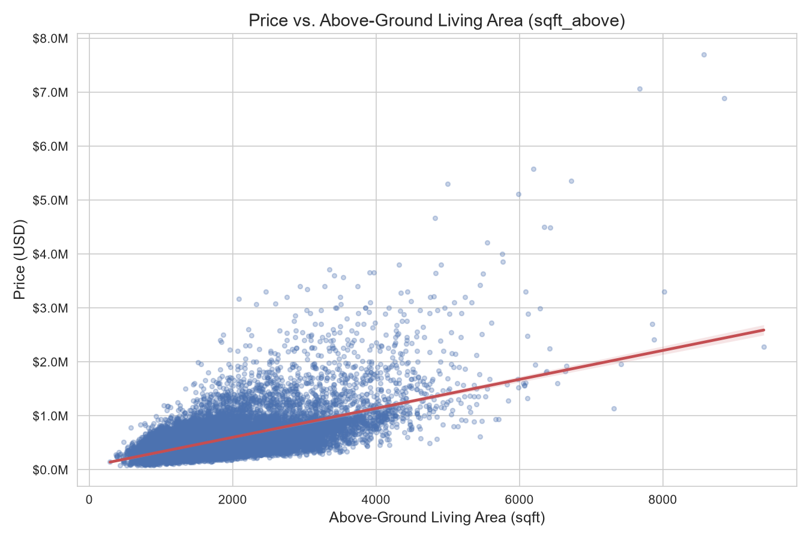

# DUAN QINGRU — Data Science Portfolio

> Student ID: **MC635497** · MSc in Data Science, CISC7204, University of Macau

## About Me

Hello! I am a data science student at the University of Macau with a growing interest in **regression modelling, exploratory data analysis, and turning tabular data into actionable business insights**. My coursework in CISC7204 covers the full data-analysis pipeline — from data wrangling and visualisation to model development, evaluation, and refinement. This portfolio showcases my completed housing-price prediction project.

## Technical Skills

| Category | Tools & Technologies |
|---|---|
| Languages | Python, SQL (basic) |
| Data analysis | pandas, NumPy, Jupyter Notebook |
| Visualisation | Matplotlib, Seaborn (boxplot, regplot) |
| Machine learning | scikit-learn — Linear / Polynomial / Ridge regression, Pipeline, train/test split |
| Tools | Git, GitHub, GitHub Pages, VS Code |

## Project Showcase

### Project: King County House Price Prediction

- **Research question:** How accurately can we predict the sale price of a house in King County (Seattle) using features such as square footage, bedrooms, bathrooms, waterfront view, and location — and which model (linear, polynomial, or regularised regression) generalises best?

- **Visualisation — `sqft_above` vs. `price` regression plot:**

  

- **Brief explanation of findings:**
  The analysis shows that `sqft_living` is the single strongest predictor of price (simple linear regression R² ≈ 0.49). Using all features raises R² to ~0.66, and a **second-order polynomial Ridge model (α = 0.1) achieves R² ≈ 0.70 on held-out test data**, outperforming linear Ridge (0.65). Houses with a waterfront view contain the most extreme price outliers.

- **Repository:** [https://github.com/DuanQingru/data-science-project](https://github.com/DuanQingru/data-science-project)

- **Current status:** ✅ **Completed** (CISC7204 Module 06 Final Project, 2026)

---

## Contact

- GitHub: [https://github.com/DuanQingru](https://github.com/DuanQingru)
- Student email: [mc63549@um.edu.mo](mailto:your-student-email@um.edu.mo)

---

